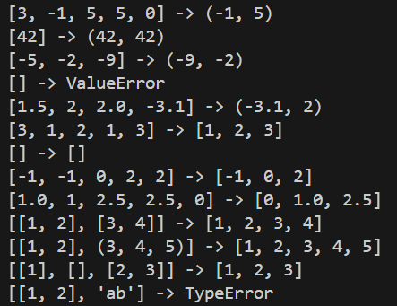
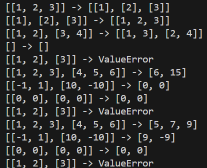
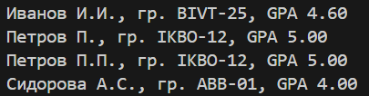
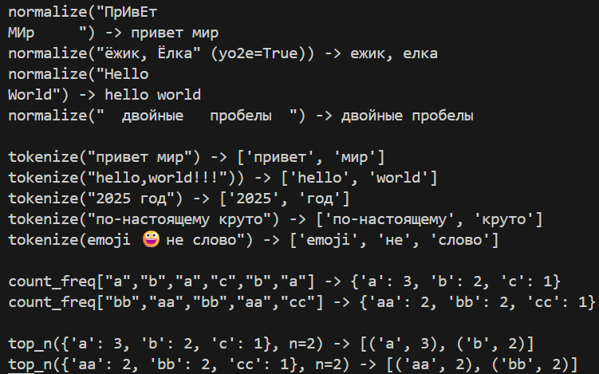
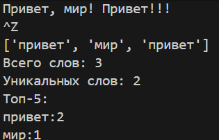

# Лабораторная работа №1

## Задание 1: Привет и возраст

Код запрашивает имя и возраст, выводит имя с возрастом в следующем году.


## Задание 2: Сумма и среднее

Код запрашивает два числа, выводит их сумму и среднее.


## Задание 3: Чек: Скидка и НДС

Код запрашивает 3 входных данных, выводит базу после скидки, НДС и сумму к оплате.


## Задание 4: Минуты -> ЧЧ:ММ

Код запрашивает время в минутах, выводит время в формате ЧЧ:ММ.


## Задание 5: Инициалы и длина строки

Код запрашивает ФИО, выводит инициалы и длинну ФИО без учёта лишних пробелов.


# Лабораторная работа №2

## Задание 1: arrays.py

Код делает тесты по трём функциям:
1. Вернуть кортеж (минимум/максимум). Если список пуст — ValueError.
2. Вернуть отсортированный список уникальных значений (по возрастанию).
3. «Расплющить» список списков/кортежей в один список по строкам (row-major). Если встретилась строка/элемент, который не является списком/кортежем — TypeError.



## Задание 2: matrix.py

Код делает тесты по трём функциям:
1. Поменять строки и столбцы местами. Пустая матрица [] → [].
Если матрица «рваная» (строки разной длины) — ValueError.
2. Сумма по каждой строке. Требуется прямоугольность.
3. Сумма по каждому столбцу. Требуется прямоугольность.



## Задание 3: tuples.py

Код делает тесты, определяя тип записи студента как кортеж и возвращает строку определённого вида.



# Лабораторная работа №3
## Задание 1: text.py

Код реализует 4 функции:
1. normalize — нормализует полученный текст в строку с перечислением слов через пробел.
2. tokenize — разбивает строку на массив со словами по небуквенно-цифровым разделителям.
3. count_freq — подсчитывает частоты, возвращает словарь "слово -> количество".
4. top_n — возвращает топ-n по убыванию частоты, при равенстве — по алфавиту слова. 

```python
import re

def normalize(text: str, *, casefold: bool = True, yo2e: bool = True) -> str:
    if casefold:
        text = text.casefold()
    else: 
        text = text.lower()
    if yo2e:
        text = text.replace('Ё' ,'Е').replace('ё','е')
    text = ' '.join(text.split())

    return text

def tokenize(text: str) -> list[str]:
    matches = re.finditer(r'\w+(-\w+)*', text)
    res = []
    for alphas in matches:
        res.append(alphas.group())
    return res


def count_freq(tokens: list[str]) -> dict[str, int]:
    word_counts = {}

    for token in tokens:
        if token in word_counts:
            word_counts[token] += 1
        else:
            word_counts[token] = 1

    return dict(sorted(word_counts.items()))

def top_n(freq: dict[str, int], n: int = 5) -> list[tuple[str, int]]:
    freqs = sorted(freq.items(), key = lambda x: (-x[1], x[0]))[:n]
    return freqs
```

Пример запуска:



## Задание 2: text_stats.py

Код считывает вводимый текст до EOF, вызывая функции из text.py и печатает:
1. Всего слов: <N>
2. Уникальных слов: <K>
3. Топ-5: — по строке на запись в формате "слово:кол-во" (по убыванию, как в top_n)

```python
from pathlib import Path
import sys

sys.path.insert(0, str(Path(__file__).resolve().parent.parent))

from lib.text import normalize, tokenize, count_freq, top_n

def main() -> None:
    sys.stdin.reconfigure(encoding="utf-8")
    raw_text = sys.stdin.read()

    tokens = tokenize(normalize(raw_text))
    freq = count_freq(tokens)
    print(tokens)
    print(f"Всего слов: {len(tokens)}")
    print(f"Уникальных слов: {len(freq)}")
    print("Топ-5:")
    for word, count in top_n(freq, n=5):
        print(f"{word}:{count}")

if __name__ == "__main__":
    main()
```

Пример запуска:

