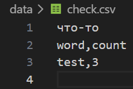
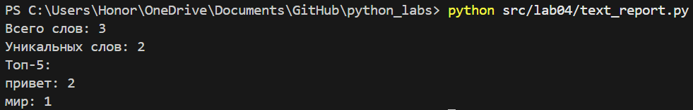
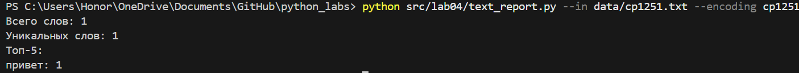

# Задание A - модуль **src/lab04/io_txt_csv.py**

Реализовано чтение текстовых файлов и запись CSV файлов.

## 1. **read_text**

Функция читает файл и возвращает его содержимое в виде одной строки. По умолчанию используется кодировка UTF-8, однако возможность поменять кодировку на другую присутствует.

## 2. **write_csv**

Функция записывает строки в CSV-файл. Перед записью проверяется, что все строки имеют одинаковую длину. Если длины отличаются, вызывается ValueError. Если передан параметр header, он записывается первой строкой файла.

## 3. **ensure_parent_dir**

Функция проверяет наличие родительской папки и создает ее вместе со всеми отсутствующими папками по пути.

## Пример запуска (С header'ом)



# Задание B - скрипт **src/lab04/text_report.py**

Скрипт читает текстовые файлы, использует функции normalize, tokenize, count_freq и top_n из лабораторной работы №3, а затем сохраняет частоты слов в CSV-файлы.

## Пример запуска

```bash
python src/lab04/text_report.py
```
Вывод:



## Кодировка cp1251

```bash
python src/lab04/text_report.py --in data/lab04/input.txt --encoding cp1251
```
Вывод:

