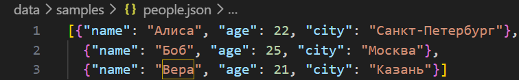
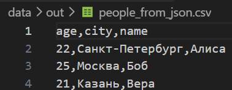
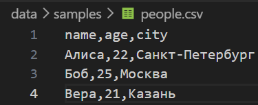
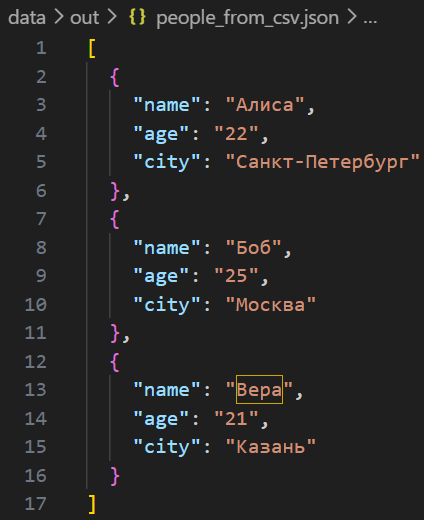
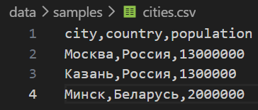
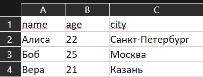
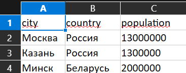

# Лабораторная работа №5
## Задание A - модуль **src/lab05/json_csv.py**

```python
import json
import csv
from pathlib import Path
from src.lib.io_helpers import read_text, write_csv, ensure_parent_dir

def json_to_csv(json_path: str, csv_path: str) -> None:

    if Path(json_path).suffix.lower() != ".json" or Path(csv_path).suffix.lower() != ".csv":
        raise ValueError("Неверный тип файла")

    if not Path(json_path).is_file():
        raise FileNotFoundError(f"Файл не найден: {csv_path}")

    text = read_text(json_path)

    if not text.strip():
        raise ValueError("Пустой json-файл")

    try:
        data = json.loads(text)
    except json.JSONDecodeError:
        raise ValueError("Ошибочный json-файл")

    if not all(isinstance(item, dict) for item in data):
        raise ValueError("json-файл должен содержать список словарей")

    fieldnames = sorted(set(
        key for item in data for key in item
    ))

    if not fieldnames:
        raise ValueError("json-файл не содержит полей")

    rows = [
        [item.get(key, "") for key in fieldnames]
        for item in data
    ]

    write_csv(rows, csv_path, header=tuple(fieldnames))


def csv_to_json(csv_path: str, json_path: str) -> None:

    if Path(csv_path).suffix.lower() != ".csv" or Path(json_path).suffix.lower() != ".json":
        raise ValueError("Неверный тип файла")

    if not Path(csv_path).is_file():
        raise FileNotFoundError(f"Файл не найден: {csv_path}")

    text = read_text(csv_path)

    try:
        reader = csv.DictReader(text.splitlines(keepends=True), strict=True)
        fieldnames = reader.fieldnames

        if not fieldnames or not all(fieldnames):
            raise ValueError("csv-файл не содержит корректного заголовка")

        if len(fieldnames) != len(set(fieldnames)):
            raise ValueError("Повторяющиеся заголовки csv-файла")

        data = list(reader)
    except csv.Error as e:
        raise ValueError("Некорректный csv-файл") from e

    if not data:
        raise ValueError("csv-файл не содержит данных")

    if any(None in row for row in data):
        raise ValueError("Слишком много столбцов в csv-файле")

    for row in data:
        for key in fieldnames:
            if row[key] is None:
                row[key] = ""

    ensure_parent_dir(json_path)

    with Path(json_path).open("w", encoding="utf-8") as f:
        json.dump(data, f, ensure_ascii=False, indent=2)


if __name__ == "__main__":
    json_to_csv(
        "data/samples/people.json",
        "data/out/people_from_json.csv"
    )
```

## Задание B - модуль **src/lab05/csv_xlsx.py**

```python
import csv
import sys
from pathlib import Path
from openpyxl import Workbook
from openpyxl.utils import get_column_letter
sys.path.insert(0, str(Path(__file__).resolve().parents[1]))
from lab04.io_txt_csv import read_text, ensure_parent_dir

def csv_to_xlsx(csv_path: str, xlsx_path: str) -> None:

    if Path(csv_path).suffix.lower() != ".csv" or Path(xlsx_path).suffix.lower() != ".xlsx":
        raise ValueError("Неверный тип файла")

    if not Path(csv_path).is_file():
            raise FileNotFoundError(f"Файл не найден: {csv_path}")

    text = read_text(csv_path)
    rows = list(csv.reader(text.splitlines()))

    if not rows or not rows[0] or not any(rows[0]):
        raise ValueError("CSV не содержит заголовка")

    if len(rows) < 2:
        raise ValueError("CSV не содержит данных")

    wb = Workbook()
    ws = wb.active
    ws.title = "Sheet1"

    for row in rows:
        ws.append(row)

    for col in ws.columns:
        max_length = max(
            len(str(cell.value)) if cell.value is not None else 0
            for cell in col
        )

        col_letter = get_column_letter(col[0].column)
        ws.column_dimensions[col_letter].width = max(8, max_length + 2)

    # Сохраняем результат
    ensure_parent_dir(xlsx_path)
    wb.save(xlsx_path)


if __name__ == "__main__":
    csv_to_xlsx(
        "data/samples/people.csv",
        "data/out/people.xlsx"
    )
    csv_to_xlsx(
            "data/samples/cities.csv",
            "data/out/cities.xlsx"
        )
```

## Демонстрация результатов

### JSON→CSV
#### Входные данные:

#### Результат:


### CSV→JSON
#### Входные данные:

#### Результат:


### CSV→XLSX
#### Входные данные:


#### Результат:

