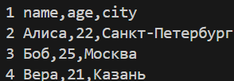
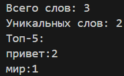
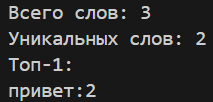
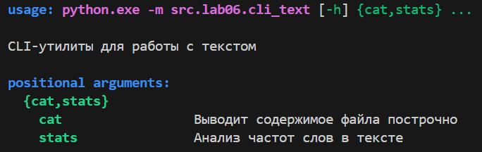
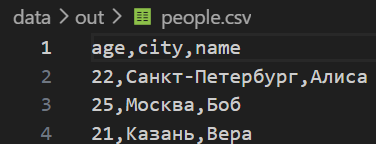
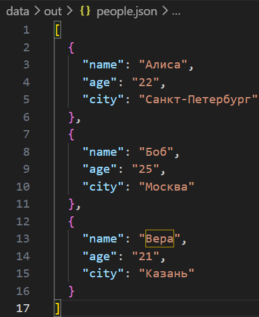
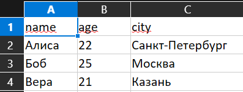
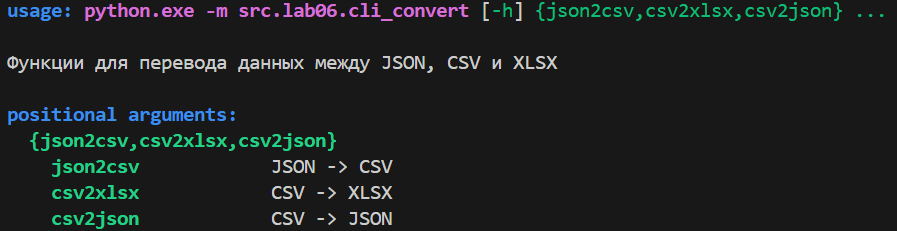
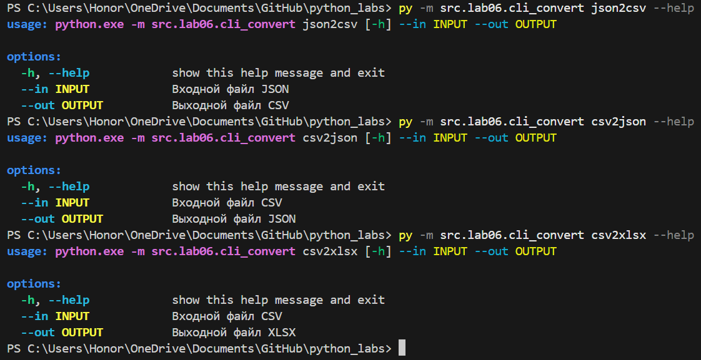

# Лабораторная работа №6
## Задание A - модуль **src/lab06/cli_text.py**

```python
from src.lib.text import normalize, tokenize, count_freq, top_n
from src.lab04.io_txt_csv import read_text 
from pathlib import Path
import argparse

def cat_command(input_path: str, numbers: bool = False) -> None:
    path = Path(input_path)

    if not path.is_file():
        raise FileNotFoundError("Файл не найден")

    with open(path, "r", encoding='utf-8') as f:
        for num, line in enumerate(f, start=1):
            if numbers:
                print(f"{num} {line}", end = "")

def stats_command(input_path: str, top: int = 5) -> None:
    path = Path(input_path)

    if not path.is_file():
        raise FileNotFoundError("Файл не найден")

    text = read_text(input_path)

    tokens = tokenize(normalize(text))
    freq = count_freq(tokens)

    total_words = len(tokens)
    unique_words = len(freq)
    top_words = top_n(freq, top)

    print(f'Всего слов: {total_words}')
    print(f'Уникальных слов: {unique_words}')
    print(f'Топ-{top}:')
    for w, c in top_words:
        print(f"{w}:{c}")

def main():
    parser = argparse.ArgumentParser(description="CLI-утилиты для работы с текстом")
    subparsers = parser.add_subparsers(dest="command", required=True)

    # Подкоманда cat
    cat_parser = subparsers.add_parser("cat", help="Выводит содержимое файла построчно")
    cat_parser.add_argument("--input", required=True, help="Путь к входному текстовому файлу")
    cat_parser.add_argument("-n", action="store_true", help="Выводить номера строк")

    # Подкоманда stats
    stats_parser = subparsers.add_parser("stats", help="Анализ частот слов в тексте")
    stats_parser.add_argument("--input", required=True, help="Путь к входному текстовому файлу")
    stats_parser.add_argument("--top", type=int, default=5, help="Количество слов в топе (по умолчанию 5)")

    args = parser.parse_args()

    if args.command == "status" and args.top < 1:
        parser.error("--top должен быть больше 0")

    try:
        if args.command == "cat":
            cat_command(args.input, args.n)
        elif args.command == "stats":
            stats_command(args.input, args.top)

    except FileNotFoundError:
        parser.error(f"Файл не найден: {args.input}")
    except UnicodeDecodeError:
        parser.error(f"Файл {args.input} написан в кодировке, отличной от UTF-8")

if __name__ == "__main__":
    main()
```

### Команды и выводы:

```python
py -m src.lab06.cli_text cat --input data/samples/people.csv -n
```


```python
py -m src.lab06.cli_text stats --input data/input.txt
```


```python
py -m src.lab06.cli_text stats --input data/input.txt --top 1
```


```python
py -m src.lab06.cli_text --help
```


## Задание B - модуль **src/lab06/cli_convert.py**

```python
import argparse
from pathlib import Path

from src.lab05.json_csv import json_to_csv, csv_to_json
from src.lab05.csv_xlsx import csv_to_xlsx

def main():
    parser = argparse.ArgumentParser(description="Функции для перевода данных между JSON, CSV и XLSX")
    subparsers = parser.add_subparsers(dest="command", required=True)

    json2csv_parser = subparsers.add_parser("json2csv", help="JSON -> CSV")
    json2csv_parser.add_argument("--in", dest = "input", required=True, help="Входной файл JSON")
    json2csv_parser.add_argument("--out", dest= "output", required=True, help="Выходной файл CSV")

    csv2xlsx_parser = subparsers.add_parser("csv2xlsx", help="CSV -> XLSX")
    csv2xlsx_parser.add_argument("--in", dest="input", required=True, help="Входной файл CSV")
    csv2xlsx_parser.add_argument("--out", dest="output", required=True, help="Выходной файл XLSX")

    csv2json_parser = subparsers.add_parser("csv2json", help="CSV -> JSON")
    csv2json_parser.add_argument("--in", dest="input", required=True, help="Входной файл CSV")
    csv2json_parser.add_argument("--out", dest="output", required=True, help="Выходной файл JSON")

    args = parser.parse_args()

    try:
        if args.command == "json2csv":
            json_to_csv(Path(args.input), Path(args.output))

        elif args.command == "csv2json":
            csv_to_json(Path(args.input), Path(args.output))

        elif args.command == "csv2xlsx":
            csv_to_xlsx(Path(args.input), Path(args.output))
            
    except FileNotFoundError:
        parser.error(f"Файл не найден: {args.input}")
    except UnicodeDecodeError:
        parser.error(f"Файл {args.input} написан в кодировке, отличной от UTF-8")
    except ValueError as error:
        parser.error(str(error))

if __name__ == "__main__":
    main()
```

### Команды и выводы:

```python
py -m src.lab06.cli_convert json2csv --in data/samples/people.json --out data/out/people.csv
```


```python
py -m src.lab06.cli_convert csv2json --in data/samples/people.csv --out data/out/people.json
```


```python
py -m src.lab06.cli_convert csv2xlsx --in data/samples/people.csv --out data/out/people.xlsx
```


```python
py -m src.lab06.cli_convert --help
```


```python
py -m src.lab06.cli_convert json2csv --help
py -m src.lab06.cli_convert csv2json --help
py -m src.lab06.cli_convert csv2xlsx --help
```


## Ошибки:
FileNotFoundError — если файл по указанному пути не найден.
UnicodeDecodeError — если файл сохранен в кодировке, отличной от UTF-8.